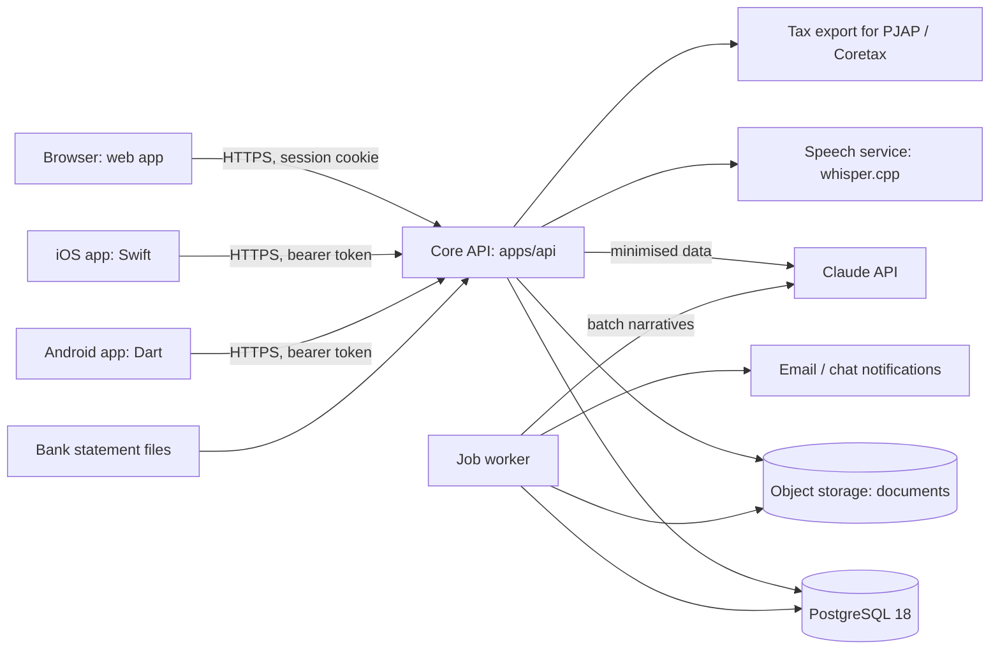

# Architecture: enterprise finance reporting system

Status: stage 2 implemented in `apps/api` on 2026-10-28; later stages proposed. Decisions marked "ADR" get a decision record in `docs/adr/` when the stage that implements them starts ([ROADMAP.md](ROADMAP.md)). Versions were checked on 2026-10-28 with `node scripts/tech-lookup.mjs` (endoflife.date and the npm registry).

## 1. Shape

A modular monolith: one deployable web application with clear internal modules, one PostgreSQL database, a job worker and a self-hosted speech service. It is the simplest structure that meets the requirements; modules can be split out later if load or team size requires it ([software-architecture](../.agents/skills/software-architecture/SKILL.md)).

## 2. Modules

| Module | Responsibility | Owns tables |
| :--- | :--- | :--- |
| Identity and access | SSO login (OpenID Connect), sessions, roles per entity, approval thresholds | users, roles, memberships, thresholds |
| Organisation | Entities, fiscal calendars, currencies, reporting framework per entity | entities, periods, currencies, fx_rates |
| Ledger | Chart of accounts, dimensions, journal entries, posting, reversal | accounts, dimensions, journal_entries, journal_lines |
| Capture | Text, voice and document capture to draft entries; AI extraction | capture_sessions, documents |
| Banking | Statement import, deduplication, matching, reconciliation | bank_accounts, bank_lines, reconciliations |
| Approvals | Maker-checker workflow, delegation | approval_requests, approval_steps |
| Close | Close checklist, locks, reopen | close_tasks, period_locks |
| Reporting | Report functions, snapshots, exports | report_runs, report_snapshots |
| Tax | Tax codes, tax reports, exports | tax_codes, tax_exports |
| Assistant | Ledger questions with read-only tools, narrative drafts, anomaly flags | ai_interactions, anomaly_flags |
| Audit | Append-only hash-chained events, retention | audit_events |

Modules call each other through their public functions only; the reporting module reads ledger data through views, never by writing.

## 3. Technology choices

| Concern | Choice | Reason |
| :--- | :--- | :--- |
| Runtime | Node.js 24 LTS (latest 24.22.1, end of life 2028-04-30) | Matches the spec tooling; LTS line |
| Language | TypeScript, strict | Types for money and IDs ([02-clean-code](../.agents/rules/02-clean-code.md)) |
| Database | PostgreSQL 18 (latest 18.6, end of life 2030-11-14) | `NUMERIC` and `BIGINT` for exact money, constraints, deferred constraint triggers for balance checks, row-level security for entity isolation, mature backup and replication |
| Web front end | React 19 (19.3.1) with Vite (8.3.5), ADR | Component model for a data-heavy app; Projects 26 already uses React and Vite |
| iOS app | Swift with SwiftUI | Owner's choice; native platform conventions, Keychain |
| Android app | Dart with Flutter | Owner's choice; one Dart code base, Android Keystore through secure storage |
| Contract | OpenAPI 3.1 in `packages/contract/openapi.json`, checked against the running API | One source of truth for three clients |
| Charts | Accessible charts with a data-table alternative, ADR on the library | [data-visualization-design](../.agents/skills/data-visualization-design/SKILL.md) |
| AI | Claude API through `@anthropic-ai/sdk` (1.3.0), model `claude-opus-5-5` from configuration | Structured outputs, tool use, prompt caching, batches ([AI and speech reference](../.agents/skills/finance-reporting-systems/references/ai-and-speech.md)) |
| Speech | `whisper.cpp` server, self-hosted; browser Web Speech API with `processLocally` as an option | Audio stays under the organisation's control by default |
| Jobs | PostgreSQL-backed job queue, ADR | No extra infrastructure; jobs are transactional with data |
| Documents | S3-compatible object storage in an Indonesian region, private, server-side encryption | Retention and location duty |
| Exports | XLSX and CSV generated on the server; PDF rendered from the same stored report result, ADR on the renderer | Screen and file never disagree |

Every library is adopted through [04-dependencies](../.agents/rules/04-dependencies.md) section 9 with its version pinned in the lockfile.

## 4. Data integrity design

- Money: `amount_minor BIGINT` plus `currency CHAR(3)`; the minor-unit exponent per currency is stored in `currencies`.
- Balance: a deferred constraint trigger on `journal_lines` rejects a transaction in which a posted entry does not balance in the functional currency.
- Immutability: the application database role has no `UPDATE` or `DELETE` on posted lines and on `audit_events`; status transitions go through one stored procedure or one module function with checks.
- Entity isolation: every table has `entity_id`; row-level security policies restrict reads and writes to the user's entities, and the application also checks permissions.
- Audit chain: `audit_events.hash = SHA-256(previous_hash || canonical_json(event))`; a scheduled job verifies the chain and alerts on a break.
- Reports: `report_runs` store parameters and the framework version; `report_snapshots` store results and a content hash; exports read from snapshots.

## 5. Security design

- Authentication (implemented): email and password hashed with Argon2id, optional TOTP second factor with an encrypted seed, random session tokens stored as SHA-256 hashes and revocable; web sessions in `Secure`, `HttpOnly`, `SameSite=Lax` cookies with an Origin check on writes, native sessions as bearer tokens. Planned: passkeys once the domain is fixed, OpenID Connect single sign-on for company entities, re-authentication for approvals, bank-detail changes and period reopen.
- Authorization in one policy module, deny by default, tested per role and entity.
- Content Security Policy without inline scripts, CORS limited to configured web origins, rate limits on sign-in and registration (in memory today; a shared store before several instances run), and later on export and AI endpoints.
- Secrets in the platform's secret manager; no secret in the client bundle.
- Prompt-injection defence: uploaded documents and bank descriptions are data; the assistant's tools are read-only and scoped to the user ([06-security](../.agents/rules/06-security.md) section 7).
- Device copy (implemented). So that the apps keep working when the API or the hosting is down, each client keeps the last answer to every GET and an outbox of transactions saved while offline: IndexedDB in the browser, SQLite in the app's private storage on Android, and SQLite with file protection until first unlock on iOS. The copy holds the signed-in person's financial data at rest on the device. It is cleared at sign-out, and the apps ask first when transactions are still waiting. It is not encrypted beyond the platform's own storage protection. The server stays the source of truth: queued transactions keep their idempotency keys, go through the same validation and period rules when sent, and a refusal is shown, never retried silently.

## 6. Deployment

Container images built once in CI, deployed to a staging and a production environment in an Indonesian cloud region, managed PostgreSQL with point-in-time recovery, daily restore test in staging, and monitoring of posting errors, job failures, AI error rates and the audit-chain check. Details in stage 6 of the [roadmap](ROADMAP.md).
