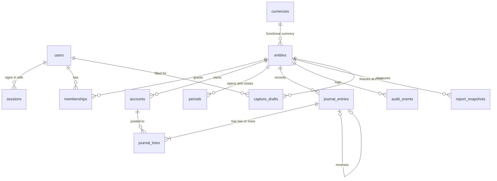

# Schema

## Entity relationship diagram

## Entities

| Table | Holds | Key columns |
| :--- | :--- | :--- |
| `currencies` | ISO 4217 currencies and their minor units | `code`, `minor_units` (IDR: 2) |
| `users` | People who sign in | `email` (unique, case-insensitive), `password_hash` (Argon2id), encrypted TOTP seed |
| `sessions` | Revocable sign-ins | `token_hash` (SHA-256 of the token), `client` (`web` or `native`), `expires_at` |
| `entities` | Books kept for one person or company | `kind`, `functional_currency`, `time_zone` (default Asia/Jakarta), `approval_required` |
| `memberships` | A user's role in an entity | `role` |
| `accounts` | Chart of accounts per entity | `code` (3 to 6 digits), `type`, `postable`, `active` |
| `periods` | Open or closed months | `year`, `month`, `status`, who changed it and why |
| `journal_entries` | Entry headers | `entry_date`, `description`, `counterparty`, `source`, `status`, `idempotency_key`, reversal links |
| `journal_lines` | Debits and credits | `debit_minor`, `credit_minor` (BIGINT minor units), `currency` |
| `audit_events` | Append-only, hash-chained log | `seq`, `chain_key`, `action`, `canonical`, `prev_hash`, `hash` |
| `report_snapshots` | Reports frozen at close | `kind`, `year`, `month`, `result` (JSON), `content_hash` |
| `capture_drafts` | One row per automatic form fill | `source` (`ai` or `rules`), `model`, `filled`, `latency_ms`, `outcome`, `changed` |
| `schema_migrations` | Applied migrations | `version`, `checksum` |

## Relationships

An entity owns its accounts, periods, entries, audit events, snapshots and capture drafts. Journal lines reference their entry and account through composite keys that include `entity_id`, so a line can never point at another entity's account. A reversal links two entries both ways (`reverses_entry_id`, `reversed_by_entry_id`). Users reach entities only through memberships.

## Invariants

Enforced by the database, so no code path can break them:

- A posted entry balances: total debits equal total credits (deferred constraint trigger, checked at commit).
- Each line is either a debit or a credit, never negative.
- Posted lines, audit events and snapshots cannot be updated or deleted, and their tables cannot be truncated.
- Entry status moves only along allowed transitions (submitted → posted or rejected; posted → reversed).
- No entry is posted into a closed period.
- A capture review lists only fields that the draft filled, and is recorded once.

## Data classification

| Class | Tables and columns |
| :--- | :--- |
| Secret | `users.password_hash`, TOTP seed (encrypted with `TOTP_KEY`), `sessions.token_hash` |
| Personal | `users.email`, `users.display_name` |
| Confidential financial | Journal entries and lines, accounts, snapshots, audit events |
| Internal metrics | `capture_drafts` (no sentence, no amounts) |

## Source of truth

The PostgreSQL database is the only source of truth. Device copies in the apps (IndexedDB, SQLite) are caches and an outbox: queued transactions become real only when the API accepts them, and the device copy is replaced by the server's answer whenever the server can be reached.
