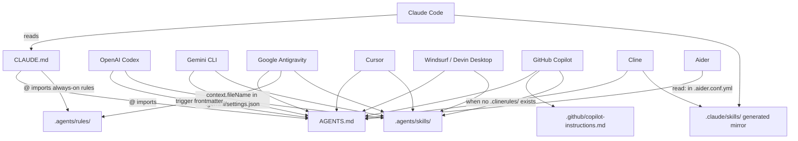

# Architecture

How the Projects 24 specification is organised, why, and how each AI tool loads it. It extends the engineering specification of Projects 23 with design and front-end rules, skills, templates and a reference library.

## 1. The problem

1. **Long instructions are followed less reliably.** Research shows that language models use information in the middle of long inputs less reliably than information at the start or end ([Liu et al., "Lost in the Middle", TACL](https://arxiv.org/abs/2307.03172)). Accuracy also falls as the number of simultaneous instructions grows: in the IFScale benchmark, even the best frontier models reached only 68% accuracy at 500 instructions ([Jaroslawicz et al., 2025](https://arxiv.org/abs/2507.11538)). Claude Code's documentation gives the practical consequence: keep each `CLAUDE.md` under 200 lines, because "longer files consume more context and reduce adherence" ([source](https://code.claude.com/docs/en/memory)).
2. **Every tool looks in a different place.** `CLAUDE.md`, `GEMINI.md`, `.github/copilot-instructions.md`, `.cursor/rules/`, `.windsurf/rules/`, `.clinerules/`, `.agents/`... Copying the same rules into each location makes them drift apart.
3. **Context is shared with the actual work.** Every token of always-on instructions is a token not available for the user's code.

## 2. The design: a small core plus on-demand detail

```text
┌──────────────────────────────────────────────────────────────────────┐
│ Core (always loaded): AGENTS.md, about 173 lines                     │
│ Priorities, non-negotiables, workflow, indexes, operating conditions │
└──────────────────────────────────────────────────────────────────────┘
          │ links to                               │ links to
          ▼                                        ▼
┌───────────────────────────────────┐   ┌───────────────────────────────────┐
│ Rules (.agents/rules/)            │   │ Skills (.agents/skills/)          │
│ always_on: 01-03, 06, 09, 10, 15  │   │ Loaded when the task matches (37):│
│ model_decision (on demand):       │   │ research, UI, graphic, motion,    │
│   04, 05, 07, 08, 11-14, 16       │   │ photo, video, colour grading,     │
│                                   │   │ data viz, tokens, Figma, handoff, │
│ Short, normative "must" rules     │   │ front-end, CSS, mobile, integra-  │
│                                   │   │ tions, a11y, perf, test, deploy,  │
│                                   │   │ review, plus the engineering set  │
└───────────────────────────────────┘   └───────────────────────────────────┘
```

- **Rules** say *what* must hold. Seven are always on, because they apply to every task (principles, clean code, verification, security, design principles, accessibility, clean execution). Eight load only when relevant (dependencies, errors, testing, Git, front-end code, performance, assets and licensing, UX writing and ethics).
- **Skills** say *how* to do a kind of task, step by step. They follow the [Agent Skills specification](https://agentskills.io/specification): only each skill's name and description are loaded at startup, and the body loads when the task matches. Bulky material sits in `references/` and `assets/` and loads only when needed.
- **Reference library**: [`DESIGN-REFERENCES.md`](DESIGN-REFERENCES.md) collects primary sources (standards, official docs) and learning resources by topic; [`TOOLKIT.md`](TOOLKIT.md) catalogues commonly used tools with official links; [`PROMPT-LIBRARY.md`](PROMPT-LIBRARY.md) holds ready-to-use prompts. None is loaded automatically; rules and skills link into them. `node scripts/check-links.mjs` checks every external link.
- **Open-ended tool coverage**: no list can name every tool, so [rule 04 section 9](../../.agents/rules/04-dependencies.md) defines how to adopt any tool, framework or service safely.
- **Size**: `node scripts/agents-sync.mjs` prints the current always-on estimate (characters divided by 4). On 2026-10-28 it was about 17,500 tokens for `AGENTS.md` plus the seven always-on rules. Antigravity's documented budget for global and always-on rules is 20,000 tokens.

## 3. How each tool loads the spec



Where a tool does not load `.agents/rules/` itself, the indexes in `AGENTS.md` tell the agent which file to open. Sources for every edge are listed in the README's compatibility table.

## 4. The sync and validation script

`scripts/agents-sync.mjs` (Node.js, no dependencies) keeps the copies consistent and catches mistakes before an agent sees them:

1. **Mirror**: copies each skill from `.agents/skills/` to `.claude/skills/`. A manifest (`.claude/skills/.agents-sync.json`) records which skills it created, so it removes only its own stale copies and never touches skills you added by hand.
2. **Drift check** (`--check`): compares SHA-256 fingerprints of source and mirror and fails if they differ.
3. **Skill validation**: frontmatter per the Agent Skills specification (name format and length, name matches folder, description length, body under 500 lines).
4. **Rule validation**: a valid `trigger` (Antigravity silently drops rules without one), a description for `model_decision` rules, and at most 12,000 characters (Windsurf's per-file limit, the strictest of the tools).
5. **Strict YAML**: rejects frontmatter that real YAML parsers would reject or read differently, such as an unquoted value containing `: `.
6. **Consistency**: `AGENTS.md` must link every rule and skill; `CLAUDE.md` must import `AGENTS.md` and should import every always-on rule.
7. **Links**: every relative link in the spec files must resolve; `file://` links are rejected. `--all-markdown` extends the check to every Markdown file in the repository.

## 5. Design decisions

| Decision | Reason | Trade-off |
| :--- | :--- | :--- |
| `AGENTS.md` as the single core | Read natively by most tools; an open standard under the Linux Foundation's Agentic AI Foundation | Tools without native support need a thin adapter file |
| Rules in `.agents/rules/` with Antigravity/Windsurf `trigger` frontmatter | One format that at least one tool loads natively, readable as plain Markdown by the rest | Other tools reach them only through the index |
| Generated `.claude/skills/` mirror | Claude Code and Cline do not read `.agents/skills/` | Tools that read both folders (Cursor, Copilot) list each skill twice, with identical content |
| No `.cursorrules` / `.windsurfrules` | Both tools read `AGENTS.md`; extra files would load the same rules twice | Teams wanting glob-scoped Cursor rules must add `.cursor/rules/*.mdc` themselves |
| Verified, runnable templates | Examples that do not run teach agents to write code that does not run | Templates must be re-verified when runtimes change |
| Accessibility and design principles always on | Accessibility failures are cheapest to prevent at the first sketch or line of code, and every UI task touches them | About 2,500 more always-on tokens than Projects 23 |
| Tokens tested for contrast in CI | Contrast is the most common WCAG failure on home pages ([WebAIM Million](https://webaim.org/projects/million/)); a token change can break every screen at once | Only sRGB colours supported by the template |
| Dated versions and Baseline status in references | Front-end advice goes stale quickly; dated facts can be re-checked | References need periodic refresh |
| External link checker kept out of the blocking CI job | Third-party sites time out or block bots; a flaky link must not block a merge | Broken links are found by the scheduled job, not on every push |
