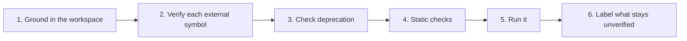

# Anti-Hallucination Playbook

Language models produce fluent, confident text whether or not it is true. In code this shows up as APIs, flags and packages that look right but do not exist. This playbook explains the common failure modes and the checks in [rule 03](../../../.agents/rules/03-verification.md) that catch them. Following it reduces fabrication; no written rule can guarantee a model never makes a mistake, which is why every claim must be checked by running something.

## 1. Failure modes and countermeasures

| Failure | Example | Risk | Countermeasure |
| :--- | :--- | :--- | :--- |
| Phantom package | Importing `node-crypto-kit` (checked on 2026-10-14: no such package on npm) | Attackers register names that models tend to invent ("slopsquatting") and wait for installs | Confirm the exact name, publisher and repository in the official registry before installing |
| Look-alike package | `reqeusts` instead of `requests` (not registered on PyPI on 2026-10-14, but anyone could register it) | Typosquatted malware | Copy names from the registry or official docs, never from memory |
| Phantom API | Calling a method that exists only in a newer version, or never existed | Runtime errors in production | Read the installed type definitions or source; check the version in the lockfile |
| Phantom flag | `tar --strip-path=1` (the real GNU and BSD flag is `--strip-components`) | Failed or destructive commands | Check `<tool> --help` or the man page for the installed version |
| Deprecated pattern | `new Buffer(n)`, `datetime.utcnow()` | Security bugs (older `Buffer(n)` could expose uninitialised memory), warnings, breakage on upgrade | Deprecation table in rule 03; the runtime's deprecation warnings |
| Silent suppression | `any`, `@ts-ignore`, `# type: ignore` to make errors disappear | Real defects hidden from the type checker | Forbidden without the user's approval and an inline reason |
| Invented verification | "All tests pass" without running them | Broken code shipped with false confidence | Quote the command and its real output; say "not run" when it was not |
| Stale facts | "Node 20 is the current LTS" after its end of life | Unsupported, insecure runtimes | Date every version claim and link the official release schedule |
| Weak test of a safety tool | A fake secret like `ghp_aaaa...` that a scanner ignores because of low entropy | Believing a scanner works when it was never really tested | Test scanners with realistic samples and confirm they fail |

## 2. The verification protocol in short

Rule 03 defines six steps. Condensed:



1. **Ground**: read manifests and lockfiles; check the runtime version actually installed.
2. **Verify symbols**: installed source and types, then `--help`, then the official docs for that exact version.
3. **Deprecation**: changelogs and migration guides when crossing major versions.
4. **Static checks**: the compiler or type checker (`tsc --noEmit`, `mypy`, `go build ./...` and `go vet ./...`, `cargo check`), then the linter.
5. **Run**: tests or a minimal reproduction; read the actual output.
6. **Label**: say explicitly what could not be checked and how the user can check it.

## 3. When the environment blocks verification

No network, missing tools, or a chat-only model: do not guess. Report like this:

```text
Changed:    src/auth/revoke.ts (token revocation endpoint)
Verified:   npm test → 57 passed, 0 failed; npx --no-install tsc --noEmit → no errors
Not done:   integration test against Redis (Redis is not available in this environment)
            Run: docker run -d -p 6379:6379 redis:8 && npm run test:integration
Risks:      REDIS_URL must be set in staging before deploy
```
