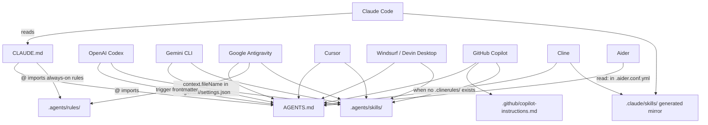
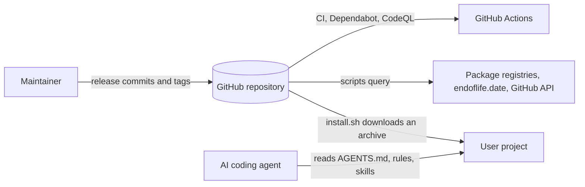

# Architecture

How Projects 23 is organised, why, and how each AI coding tool loads it.

## 1. The problem

1. **Long instructions are followed less reliably.** Research shows that language models use information in the middle of long inputs less reliably than information at the start or end ([Liu et al., "Lost in the Middle", TACL](https://arxiv.org/abs/2307.03172)). Accuracy also falls as the number of simultaneous instructions grows: in the IFScale benchmark, even the best frontier models reached only 68% accuracy at 500 instructions ([Jaroslawicz et al., 2025](https://arxiv.org/abs/2507.11538)). Claude Code's documentation gives the practical consequence: keep each `CLAUDE.md` under 200 lines, because "longer files consume more context and reduce adherence" ([source](https://code.claude.com/docs/en/memory)).
2. **Every tool looks in a different place.** `CLAUDE.md`, `GEMINI.md`, `.github/copilot-instructions.md`, `.cursor/rules/`, `.windsurf/rules/`, `.clinerules/`, `.agents/`... Copying the same rules into each location makes them drift apart.
3. **Context is shared with the actual work.** Every token of always-on instructions is a token not available for the user's code.

## 2. The design: a small core plus on-demand detail

```text
┌──────────────────────────────────────────────────────────────────────┐
│ Core (always loaded): AGENTS.md, about 153 lines                     │
│ Priorities, non-negotiables, workflow, indexes, operating conditions │
└──────────────────────────────────────────────────────────────────────┘
          │ links to                               │ links to
          ▼                                        ▼
┌───────────────────────────────────┐   ┌───────────────────────────────────┐
│ Rules (.agents/rules/)            │   │ Skills (.agents/skills/)          │
│ always_on: 01, 02, 03, 06, 09     │   │ Loaded when the task matches:     │
│ model_decision (on demand):       │   │ 15 lifecycle skills (specify...   │
│   04, 05, 07, 08                  │   │ adopt) and 15 domain skills       │
│ Short, normative "must" rules     │   │ (backend ... QA). Procedures plus │
│                                   │   │ verified templates and references │
└───────────────────────────────────┘   └───────────────────────────────────┘
```

- **Rules** say *what* must hold. Five are always on, because they apply to every task (principles, clean code, verification, security, clean execution). Four load only when relevant.
- **Skills** say *how* to do a kind of task, step by step. They follow the [Agent Skills specification](https://agentskills.io/specification): only each skill's name and description are loaded at startup, and the body loads when the task matches. Bulky material sits in `references/` and `assets/` and loads only when needed.
- **Size**: `node scripts/agents-sync.mjs` prints the current always-on estimate (characters divided by 4). On 2026-10-26 it was about 12,300 tokens for `AGENTS.md` plus the five always-on rules. Tools that support skills also load every skill's name and description at startup: for the 30 skills that is 15,945 characters, about 4,000 tokens. Skill bodies load only when the task matches. Antigravity's documented budget for global and always-on rules is 20,000 tokens.

## 3. How each tool loads the spec



Where a tool does not load `.agents/rules/` itself, the indexes in `AGENTS.md` tell the agent which file to open. Sources for every edge are listed in the README's compatibility table.

## 4. The sync and validation script

`scripts/agents-sync.mjs` (Node.js, no dependencies) keeps the copies consistent and catches mistakes before an agent sees them:

1. **Mirror**: copies each skill from `.agents/skills/` to `.claude/skills/`. A manifest (`.claude/skills/.agents-sync.json`) records which skills it created, so it removes only its own stale copies and never touches skills you added by hand.
2. **Drift check** (`--check`): compares SHA-256 fingerprints of source and mirror and fails if they differ.
3. **Skill validation**: frontmatter per the Agent Skills specification (name format and length, name matches folder, description length, body under 500 lines).
4. **Rule validation**: a valid `trigger` (Antigravity silently drops rules without one), a description for `model_decision` rules, and at most 12,000 characters (Windsurf's per-file limit, the strictest of the tools).
5. **Strict YAML**: rejects frontmatter that real YAML parsers would reject or read differently, such as an unquoted value containing `: `.
6. **Consistency**: `AGENTS.md` must link every rule and skill; `CLAUDE.md` must import `AGENTS.md` and should import every always-on rule.
7. **Links**: every relative link in the spec files must resolve; `file://` links are rejected. `--all-markdown` extends the check to every Markdown file in the repository.

## 5. Design decisions

| Decision | Reason | Trade-off |
| :--- | :--- | :--- |
| `AGENTS.md` as the single core | Read natively by most tools; an open standard under the Linux Foundation's Agentic AI Foundation | Tools without native support need a thin adapter file |
| Rules in `.agents/rules/` with Antigravity/Windsurf `trigger` frontmatter | One format that at least one tool loads natively, readable as plain Markdown by the rest | Other tools reach them only through the index |
| Generated `.claude/skills/` mirror | Claude Code and Cline do not read `.agents/skills/` | Tools that read both folders (Cursor, Copilot) list each skill twice, with identical content |
| No `.cursorrules` / `.windsurfrules` | Both tools read `AGENTS.md`; extra files would load the same rules twice | Teams wanting glob-scoped Cursor rules must add `.cursor/rules/*.mdc` themselves |
| Verified, runnable templates | Examples that do not run teach agents to write code that does not run | Templates must be re-verified when runtimes change |

The sections below complete the standard architecture outline ([technical-documentation](../../../.agents/skills/technical-documentation/SKILL.md) section 5); sections 1 to 5 above remain the detailed explanation.

## Overview

Projects 23 is a specification for AI coding agents, distributed as files: a small always-on core (`AGENTS.md` and five always-on rules), on-demand rules and skills, thin adapter files for each tool, dependency-free scripts that validate and install it, and runnable templates that CI executes. Users copy it into their projects with `scripts/install.sh`; agents load it at the start of each session.

## System context



## Containers and components

| Container | Responsibility | Technology | Owner |
| :--- | :--- | :--- | :--- |
| Core: `AGENTS.md`, `CLAUDE.md`, adapters | Always-loaded priorities, workflow, indexes; per-tool entry points | Markdown, JSON, YAML | Repository owner |
| Rules: `.agents/rules/` | Short normative rules, five always on | Markdown with `trigger` frontmatter | Repository owner |
| Skills: `.agents/skills/` | Procedures, references and runnable assets, loaded on demand | Agent Skills format | Repository owner |
| Mirror: `.claude/skills/` | Copy for tools that read only that folder | Generated by `agents-sync.mjs` | Generated |
| Scripts: `scripts/` | Validate and mirror, look up live facts, check pins, install | Node.js standard library, Bash | Repository owner |
| CI tooling: `tools/`, `.github/` | Pinned linters and auditors, workflows, Dependabot | GitHub Actions, PyPI and npm packages | Repository owner |

## Data flow

1. **Install**: `install.sh` downloads `archive/<ref>.tar.gz`, optionally verifies its SHA-256, copies the spec files into the target without overwriting differing files, then runs `agents-sync.mjs` to generate the mirror and validate.
2. **Session**: the agent's tool loads `AGENTS.md` (directly or through its adapter), then opens the rule or skill that matches the task from the indexes.
3. **Release**: a change passes the local checks, lands on `main` as a release commit, CI re-validates everything, and a tag marks the version.

## Trust boundaries

- Download to a user's machine: HTTPS, optional `--ref` pinning and `--sha256` verification, no overwrite of existing files.
- External content adapted into the spec (other skill collections, documentation): read as data, verified at the source, paraphrased and attributed, reviewed before commit.
- Registry and API responses read by the scripts: parsed into fixed fields only, never executed.
- Contributions: reviewed by the owner; CI validates structure, runs every template and scans for secrets.

## Quality attributes

- Verifiability: every fact can be traced to a dated source, and every template runs in CI.
- Portability: any tool that reads `AGENTS.md` works; scripts need only Node.js 22 or later.
- Context efficiency: the always-on core stays under the 20,000-token budget (about 12,300 tokens on 2026-10-26).
- Safety: installing never destroys a user's files; agents are told to confirm before deleting or rewriting existing code.
- Maintainability: the repository's own code passes the same clean-code limits it prescribes.

## Key decisions

The structural decisions and their trade-offs are in section 5 above, and every later change is explained in `CHANGELOG.md`. The repository has no `docs/adr/` folder yet; a future decision that is hard to reverse gets an ADR there.

## Deployment view

There is no runtime deployment: releases are commits and tags on GitHub, and the installer copies files into user projects. Details in [DEPLOYMENT.md](DEPLOYMENT.md).

## Known limitations and technical debt

- Instructions guide agents but do not enforce; the Claude Code guard hook enforces a subset and is opt-in.
- Tools that do not load `.agents/rules/` reach rules only through the index in `AGENTS.md`.
- The Dockerfiles in the templates are linted and scanned but were not built in the authoring environment, which has no Docker.
- `check-docs.mjs` checks completeness, not correctness; dated facts in the spec can go stale between reviews.
- The commit email and the tracked `.archive/` file are publicly visible until the owner decides on a history rewrite ([SECURITY.md](SECURITY.md)).
